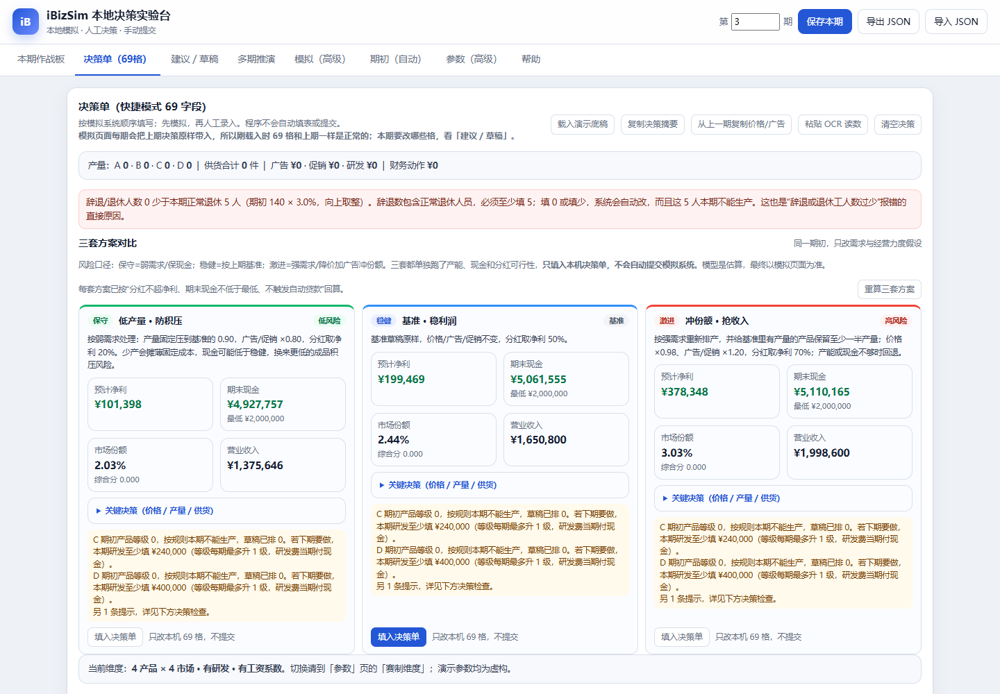

# iBizSim 本地决策实验台（非官方）

一个**完全离线**的单文件经营模拟辅助工作台：69 格决策单、产能 / 原料 / 现金模拟、保守 / 稳健 / 激进三套方案、本地 JSON 导入导出。不会连接网络，不会自动填表，也不会提交。

> 本项目是非官方、独立项目，与 iBizSim 或任何赛事组织方无隶属、认可或赞助关系。仓库内全部为虚构演示数据。



## 功能

- **69 格决策单**：价格、广告、促销、供货、四班产量、研发、招聘 / 辞退、买机器、买原料、贷款 / 债券 / 国债、分红、工资系数。
- **三套情景方案**：在同一份期初和同一套模型上生成保守、稳健、激进三种经营口径；每套都能一键填入本机决策单。
- **本地模拟**：检查产能、工人、机器、原料、供货、现金、自动贷款和粗略需求；红色 / 橙色警告先于收益优化。
- **多期推演**：比较多期买机器、研发、发债等动作对后续产量、现金和评分指标的影响。
- **手动 JSON 备份**：导出 / 导入完整本机状态；不依赖服务器、账号或云存储。
- **4×4 / 2×2 两种维度**：4×4 为 69 格，2×2 为 28 格。

## 快速开始

### 方式一：直接打开

1. 下载或克隆本仓库。
2. 双击 `index.html`，用现代浏览器（Edge / Chrome / Firefox）打开。
3. 首次打开会自动载入**虚构演示数据**，可以直接在「决策单」试用。

### 方式二：本地静态服务器（可选）

```bash
python -m http.server 8000
# 打开 http://localhost:8000
```

无需安装依赖，无需构建，也不需要 Node.js。

### 导入演示数据

内置演示数据与 [`demo/demo-state.json`](demo/demo-state.json) 一致。若想恢复初始演示状态：

1. 打开页面顶部的「导入 JSON」。
2. 选择 `demo/demo-state.json`。
3. 确认覆盖当前本机状态。

## 三套方案

三套方案都基于**同一个期初快照**和同一套本地模型，只改变需求强弱、经营力度和分红假设：

| 方案 | 需求假设 | 产量 | 广告 / 促销 | 分红 | 目标 |
|---|---:|---|---:|---:|---|
| 保守 | ×0.90 | 基准草稿的 0.90 | ×0.80 | 净利的 20% | 低产量、低积压、低投入 |
| 稳健 | ×1.00 | 基准草稿原样 | ×1.00 | 净利的 50% | 维持基准利润 |
| 激进 | ×1.10 | 重新排产，并给基准中有产量的产品保留至少一半产量 | ×1.20 | 净利的 70% | 降价、加广告、抢份额 |

注意事项：

- 三套方案都只是**本机模拟结果**，不是官方预测，也不是最优解。
- 分红会自动做安全钳制：分红不超过净利，且期末现金不低于最低现金；触发自动贷款 / 紧急贷款时下调或归零。
- 点击「填入决策单」只会覆盖本机 69 格，**不会填写或提交任何外部系统**。
- 激进方案在产能、原料或现金不可行时会自动回退到更保守的候选。

## 数据与隐私

- 所有状态只保存在浏览器的 `localStorage`，键名为 `ibizsim-workbench-public-v1`。
- 页面不发起网络请求，不加载外部脚本，不上传数据，不含遥测或统计代码。
- 导入 / 导出均为你手动选择的本地文件。
- 换电脑或清理浏览器前，请用「导出 JSON」自行备份。

更多说明见 [`docs/PRIVACY.md`](docs/PRIVACY.md)。

## 非官方声明与合规

- 本项目不是官方产品，不隶属、未获认可、未获赞助于 iBizSim 或任何模拟 / 赛事组织方。
- `iBizSim` 及相关名称、商标归其权利人所有。
- 是否允许使用本地辅助计算工具，以你所在模拟环境的规则和工作人员要求为准。
- 本工具不读取网页、不自动点击、不自动填表、不提交；最终录入和提交都由使用者本人完成。
- 演示数据全部虚构，与任何真实企业、队伍、比赛或成绩无关。

## 模型局限

- 需求、价格弹性、广告 / 促销效果、竞争反应均为粗略启发式，不是官方公式。
- 成本、产能、交付率、库存和融资参数需要按你所在环境的规则核对。
- 多期推演不考虑对手策略变化、随机事件和规则外因素。
- 结果只适合做决策对照和风险检查，不应作为成绩承诺或投资建议。

详细模型说明见 [`docs/MODEL.md`](docs/MODEL.md)，操作流程见 [`docs/WORKFLOW.md`](docs/WORKFLOW.md)。

## 目录结构

```text
.
├─ index.html                 # 单文件应用（无构建、无外部依赖）
├─ demo/
│  └─ demo-state.json         # 虚构演示状态，可通过「导入 JSON」载入
├─ docs/
│  ├─ MODEL.md                # 模型与假设
│  ├─ WORKFLOW.md             # 使用流程
│  ├─ PRIVACY.md              # 数据与隐私
│  ├─ screenshot-overview.png
│  └─ screenshot-decision.png
├─ LICENSE                    # MIT
├─ NOTICE                     # 非官方与数据声明
└─ .gitignore
```

## 开发

- 单文件 HTML / CSS / JavaScript，无框架、无构建步骤、无运行时依赖。
- 兼容现代 Chromium / Firefox；推荐桌面端使用。
- 修改后在浏览器中打开 `index.html` 做冒烟检查：三套方案能生成、能填入 69 格、无控制台报错、无网络请求。

## 许可证

[MIT](LICENSE)。版权署名使用项目通用名称，不包含任何个人信息。
